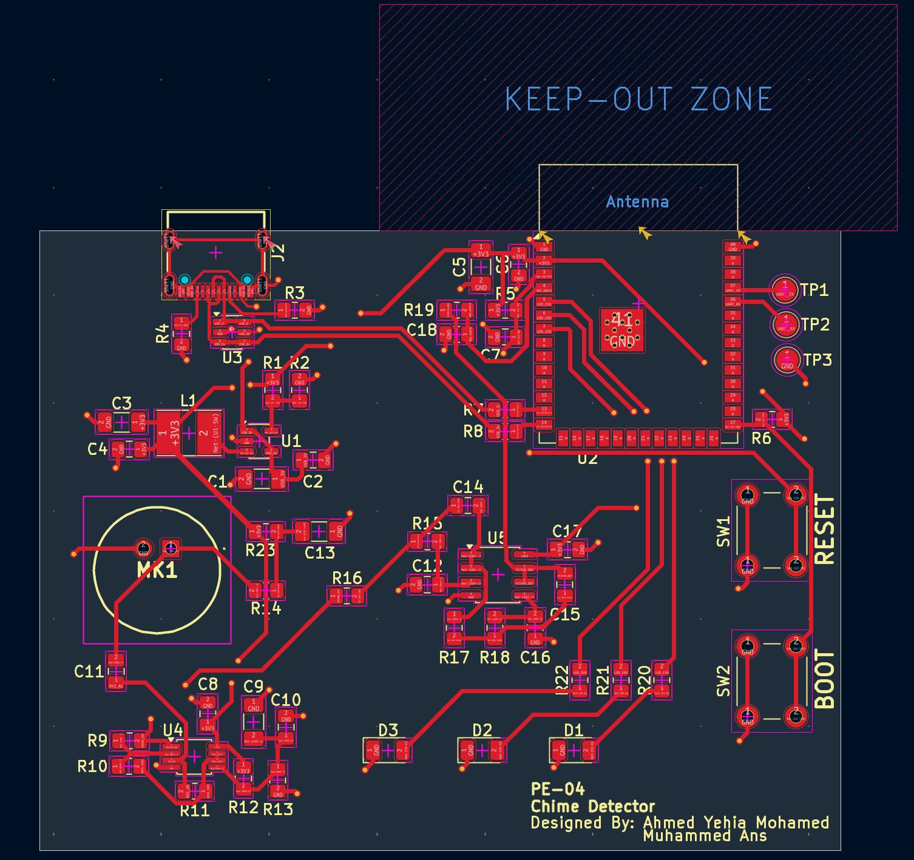
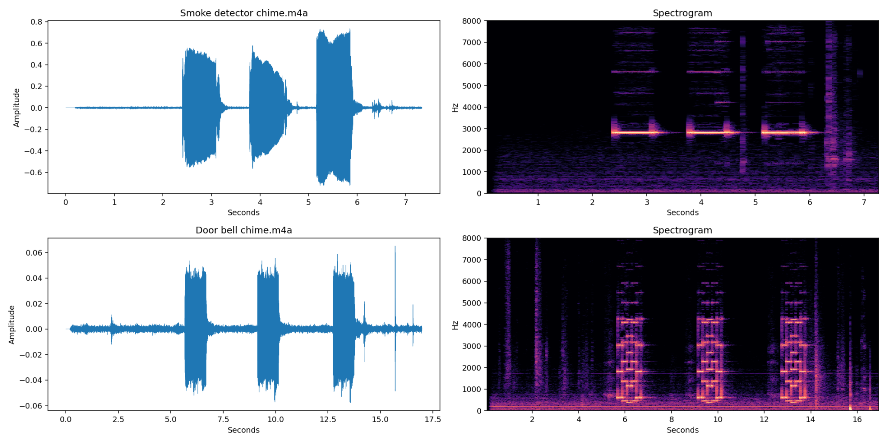

# PE-04 | ESP32-S3 Offline Chime Detector

**Muhammad Ans | Mechatronic Systems Engineering | Practical Electronics, Rhine-Waal University of Applied Sciences**

KiCad · PCB design · Analog electronics · LTspice · Signal processing

I'm developing an offline, USB-C-powered chime detector that converts recognizable household sounds into visual indications. The hardware uses an electret microphone, analog amplification and filtering, an ESP32-S3 and three LEDs. My project work includes sound analysis, Goertzel-based detection experiments, LTspice exploration and development of the team schematic and PCB.

## PCB design - Revision V2

The latest project files are dated **22 November 2026**, revision **V2**. This is our current design for the next assembly stage.

| Open in KiCad | Files |
| --- | --- |
| Schematic | [PE04_Chime_Detector.kicad_sch](hardware/current/PE04_Chime_Detector.kicad_sch) |
| PCB | [PE04_Chime_Detector.kicad_pcb](hardware/current/PE04_Chime_Detector.kicad_pcb) |
| Project | [PE04_Chime_Detector.kicad_pro](hardware/current/PE04_Chime_Detector.kicad_pro) |
| Design rules | [PE04_Chime_Detector.kicad_dru](hardware/current/PE04_Chime_Detector.kicad_dru) |
| Custom libraries | [Symbols, footprints and 3D models](hardware/current/libraries/) |

The project has 57 electronic component footprints plus four mounting holes. Its 57 electronic reference/value entries agree with the V2 schematic. We have supplied the corresponding project-local KiCad libraries, so the source files can be reviewed as a set.

*Earlier PCB routing screenshot (18 November). Open the V2 PCB file above for the latest board geometry.*

### Hardware architecture

| Section | V2 design |
| --- | --- |
| Microcontroller | ESP32-S3-WROOM-1 |
| USB-C / power | USB-C connector, USBLC6-2SC6 ESD protection, TLV62569DBV 3.3 V buck converter |
| Microphone | AOM-5024P-HD-MB-R, with bias, decoupling and AC coupling |
| Analog gain / reference | AD8656ARZ dual op-amp; buffered 1.65 V reference and nominal 11× preamp |
| Analog filter | TLV9062; two Sallen-Key stages, fourth-order low-pass design |
| ADC / indicators | GPIO4 ADC input; three independent green, blue and red LED channels |

[Read the circuit explanation](docs/hardware-architecture.md)

## My engineering work

### Sound-analysis experiments

I analyzed microwave, doorbell and smoke-alarm test recordings to compare their frequency and timing patterns. The offline detector experiment focused on the microwave's tone near 2,050 Hz. A simple frequency trigger reacted to hand claps, so I tested tone-purity and three-beep timing checks.

The development set reported the expected alerts on four microwave/clap recordings: **1, 1, 1 and 0**. Those results cover this small offline test set, not an ESP32 firmware implementation or a doorbell/smoke-alarm classifier.

[Sound-analysis details](docs/sound-analysis.md)

### LTspice microphone-front-end work

I studied microphone biasing, an analog mid-supply reference, amplification, filtering and transient response in LTspice. The saved early amplifier-plus-RC-filter sweep has about **+20.08 dB** gain at **2.054 kHz** for `V(adc_out)/V(mic_raw)`. I also investigated supply ripple and op-amp model convergence.

These LTspice screenshots document an earlier circuit iteration; they are not the measured response of the AD8656ARZ/TLV9062 V2 hardware.

[LTspice experiments](docs/ltspice-experiments.md)

### Parts and assembly preparation

The latest PCB package is accompanied by two supplementary parts lists dated **22 November 2026**. They specify 21 supplier line items covering 27 board positions, including the AD8656ARZ, three Kingbright LEDs and two pushbuttons. I matched those entries against the V2 PCB to produce a full, reference-based assembly BOM while leaving unspecified supplier parts blank.

- [V2 assembly BOM - 61 footprints](procurement/PE04_V2_Assembly_BOM.csv)
- [Supplementary selected parts and order codes](procurement/PE04_Supplementary_Selected_Parts.csv)
- [Original Excel supplements and purchasing notes](procurement/)

## Current stage

| Completed | Next |
| --- | --- |
| V2 KiCad schematic, PCB and custom libraries | Open in KiCad and record ERC/DRC results |
| Component-level BOM and supplier supplements | Confirm parts, assembly and soldering |
| Earlier LTspice and sound-analysis experiments | Capture voltage, analog and ADC measurements on assembled hardware |
| Offline microwave-pattern feasibility tests | Implement and evaluate ESP32 real-time detection and LED mappings |

No soldered or tested board is documented yet. The project is an educational assistive demonstrator, not a certified smoke-alarm system.

[Assembly and bring-up checklist](docs/assembly-and-testing.md) · [Archived earlier KiCad revision](hardware/archive/earlier-kicad-sources/)

*Team project: Muhammad Ans, with KiCad schematic and PCB collaboration from Ahmed Yehia Mohamed.*
