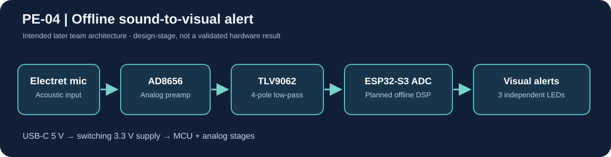

# PE-04 | ESP32-S3 Offline Chime Detector

**Practical Electronics (2314) · Winter semester 2026/27 · Rhine-Waal University of Applied Sciences**  
**University team project · Design and simulation stage · Not yet hardware-validated**

An **offline assistive visual-alert demonstrator** for selected household sounds. The intended device captures audio through an electret microphone, conditions it using an analog front-end, samples it with an ESP32-S3, and activates distinct LEDs for recognized patterns. Investigated examples include a doorbell, appliance chime, and smoke-alarm test sound.

**Safety:** This is a student demonstrator, **not a certified smoke detector or safety-alert product**.

*Team PCB layout screenshot supplied 18 November 2026. This is image evidence of routing and component placement, **not** proof of successful DRC, fabrication, assembly, or a working prototype. The matching latest native PCB files are still pending; the editable KiCad files under `hardware/archive/` belong to an earlier revision.*

## Hardware design at a glance

The following part numbers and values come from the **actual native KiCad schematic and PCB archived in this repository**; their 57 physical component reference/value pairs were compared and matched. This does not establish that the newer screenshot has identical component values.

| Subsystem | KiCad reference and design |
| --- | --- |
| Microcontroller | **U2: ESP32-S3-WROOM-1**, ADC input and three LED outputs |
| USB interface | **J2: 629722000214**, **R3/R4: 5.1 kΩ** CC resistors, **U3: USBLC6-2SC6** protection |
| Power | **U1: TLV62569DBV** buck regulator, **L1: 2.2 µH**; nominal USB 5 V to 3.3 V |
| Electret microphone | **MK1: AOM-5024P-HD-MB-R**, microphone-bias and supply filtering |
| Preamplifier/reference | **U4: AD8656**, nominal 1.65 V midpoint and **11×** non-inverting stage (R9=47 kΩ, R10=4.7 kΩ) |
| Low-pass filter | **U5: TLV9062**, two active Sallen–Key stages (fourth-order design; ~7 kHz target in the design guide) |
| ADC input | **R19: 220 Ω**, **C18: 1 nF**; ESP32-S3 ADC1_CH3/GPIO4 |
| Visual alerts | **D1 green / D2 blue / D3 red**, with **330 Ω** resistors (R20/R21/R22) |

[Full reference-by-reference KiCad component audit](docs/kicad-source-component-audit.md) · [Eight-block circuit guide](reports/eight-block-circuit-guide.pdf) · [Hardware architecture notes](docs/hardware-architecture.md)

## Engineering work and evidence

### 1. KiCad schematic and two-layer PCB design

The team design includes USB-C power/data protection, a buck regulator, electret microphone, analog midpoint reference, preamplification, low-pass filtering, ADC conditioning, ESP32-S3 programming/debug controls, and three LED indicators.

- [Latest PCB layout screenshot](images/pcb/latest-layout-screenshot-2026-11-18.jpg) — newest provided **image only**.
- [Earlier PCB layout screenshot](images/pcb/earlier-layout-screenshot.png) — historical design view.
- [Archived editable KiCad files](hardware/archive/earlier-kicad-sources/) — native earlier revision, *not* asserted to match the newest screenshot.
- [Source audit and outstanding verification](docs/kicad-source-component-audit.md) — checks documented component values and defines what remains unverified.

### 2. LTspice analog-front-end exploration — an earlier, different design iteration

An **earlier analog concept** was investigated with a 3.3 V ideal supply, electret signal model, 1.65 V reference, non-inverting amplifier, second-order Sallen–Key stage and an output RC filter. The successful combined simulations used generic op-amp models after an imported MCP6021-family model caused convergence issues.

- Investigated AC response, time-domain signal levels, model compatibility, supply ripple, startup behavior, and basic component-tolerance corners.
- Historical filter-only simulations reported approximately **−1.10 dB near 2.07 kHz** and **−34.26 dB near 14 kHz**.
- **These results do not validate the later AD8656/TLV9062 circuit in KiCad.** The original LTspice `.asc` files have not yet been added.

[LTspice experiment details](docs/ltspice-experiments.md) · [Full 36-page development report](reports/development-and-verification-report.pdf) · [Analog design comparison](docs/comparison-to-current-design.md)

### 3. Recorded sound and Goertzel-based offline feasibility

Recorded household sounds were analyzed for **frequency content and beep patterns**. An early single-frequency trigger produced false positives on hand claps; a later offline Colab experiment combined tone purity, beep duration, and repeated-beep timing. The documented prototype returned **1 / 1 / 1 / 0** expected alerts across *four known development recordings* (two microwave clips, microwave-plus-clap, and claps-only).

This was an **offline proof of concept**, not an ESP32-S3 firmware implementation or a measured real-world accuracy rate. The original notebook and audio data have not yet been uploaded.

[Sound-analysis methods and limitations](docs/sound-analysis.md)

## Design-stage status

| Area | Evidence/status |
| --- | --- |
| Requirements and architecture | Documented |
| Native KiCad schematic and PCB | **Earlier revision uploaded**; 57 component references/values match |
| Newest PCB revision | **Screenshot uploaded**; matching native source pending |
| Historical LTspice experiments | Screenshots and full report uploaded; original `.asc` pending |
| Goertzel feasibility | Development-file results documented in PDF; original notebook pending |
| KiCad ERC / DRC | **No passing reports available** |
| PCB fabrication and assembled-board testing | **Not verified** |
| Embedded firmware and field performance | **Not verified** |

The two hardware revisions and the October LTspice circuit **must not be treated as one identical tested implementation**.

## Explore the repository

| Location | What you'll find |
| --- | --- |
| [images/](images/) | Real PCB screenshot, LTspice results, sound spectrogram and system diagram |
| [docs/](docs/) | Hardware architecture, source component audit, analog comparison, sound analysis and verification plan |
| [reports/](reports/) | Full original development report and illustrated eight-block circuit guide |
| [hardware/archive/](hardware/archive/earlier-kicad-sources/) | Original editable KiCad files from an earlier design revision |
| [simulation/](simulation/) | Notes about original LTspice source files still needed |
| [software/](software/) | Notes about the recorded Goertzel prototype and future firmware |

**Next steps:** obtain the matching latest KiCad schematic/PCB/project files, run ERC and DRC, reproduce final-circuit simulations, then document assembly, voltage measurements, ADC behavior and ESP32 firmware. See [verification checklist](docs/status-and-next-steps.md).

## Team contribution and attribution

The PCB screenshots credit **Ahmed Yehia Mohamed** and **Muhammad Ans**. This repository documents available team design evidence and earlier electronic/sound-analysis investigations; it does **not** claim sole authorship of every schematic, layout or software element. Team/publication rights and redistribution permissions should be reviewed before making the repository public.
