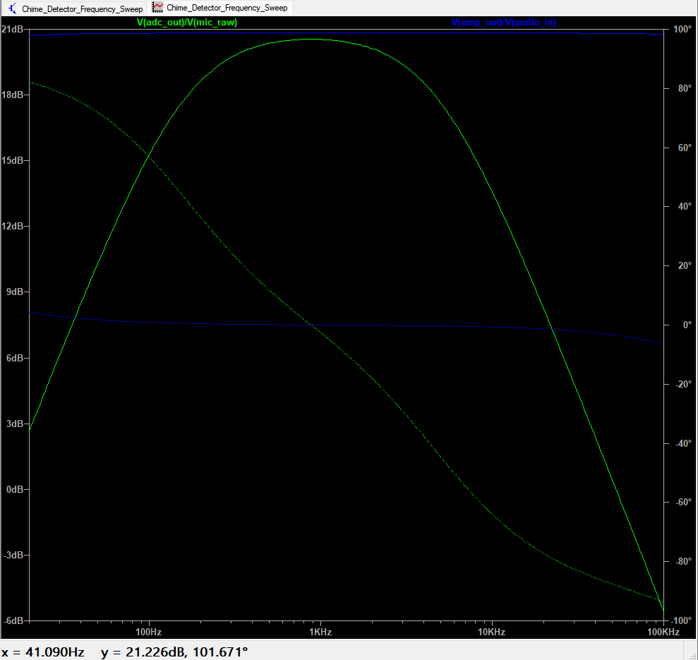

# PE-04 | ESP32-S3 Offline Chime Detector

**Practical Electronics · Rhine-Waal University of Applied Sciences · October 2026–present**

A university team project to turn recognizable household sounds into visual notifications. The design uses an electret microphone, an analog signal-conditioning circuit and an ESP32-S3 to identify selected chime patterns and drive three LEDs. The project focuses on offline operation, custom PCB design and the practical challenges of distinguishing tones from background noise.

*PCB layout in KiCad, 18 November 2026. The editable source currently published is an earlier design revision.*

## My work

- **Sound analysis:** Examined recorded microwave, doorbell and smoke-detector test chimes. Investigated false triggers caused by hand claps and evaluated frequency and timing rules for recognizing a complete beep pattern.
- **LTspice:** Developed and simulated an earlier microphone amplification and filtering concept. Explored gain, AC response, transient signals, supply ripple and op-amp model/convergence problems.
- **KiCad and integration:** Collaborated with Ahmed Yehia Mohamed on the ESP32-S3 sound-detector board, including schematic/PCB development and review of the analog signal chain and peripheral interfaces.

The PCB is collaborative work. The LTspice candidate documented below is an earlier circuit study, not a simulation of the final KiCad analog stages.

## Hardware design

| Section | Components in the archived KiCad schematic and PCB |
| --- | --- |
| Controller | ESP32-S3-WROOM-1 |
| Power | USB-C 5 V input, TLV62569DBV buck converter, 3.3 V supply |
| Microphone | AOM-5024P-HD-MB-R electret microphone |
| Analog signal chain | AD8656 preamplifier; TLV9062 active low-pass filter |
| ADC input | ESP32-S3 GPIO4 / ADC1_CH3 |
| Output | Three individually controlled red, blue and green LEDs |

The team schematic uses a nominal 1.65 V analog reference, 11× preamplifier gain and two cascaded second-order Sallen–Key filter stages. The archived KiCad schematic and PCB contain **57 matching component references and values**; this is a component comparison, not an electrical-rules check.

[Hardware design and KiCad source](docs/hardware-architecture.md)

## LTspice: analog circuit investigation

I investigated a separate 3.3 V microphone-front-end concept using an amplifier, an active filter and a final RC stage. In its **earlier generic-op-amp model**, the simulated filter response was approximately **−1.09 dB at 2.06 kHz** and **−34.24 dB at 14 kHz**. I also investigated an MCP6021-family model that produced convergence problems when two instances were used, then compared results using generic op-amp models.

These are **simulation results from the earlier design**, not measured performance of the AD8656/TLV9062 circuit on the PCB.

[Simulation approach, results and lessons](docs/ltspice-experiments.md) · [Circuit screenshot](images/ltspice/initial-frequency-sweep-schematic.png) · [Transient signals](images/ltspice/real-mic-bias-transient.png)

## Acoustic analysis and offline detection

An early frequency-only detector responded incorrectly to hand claps. The offline prototype therefore combined Goertzel tone analysis with tonal purity, beep duration and repeated-event timing. The documented development tests gave expected alert counts of **1, 1, 1 and 0** on four known recordings (two microwave examples, one microwave-plus-clapping example and claps only).

This was a small offline proof of concept, not a deployed or validated ESP32 classifier.

[Sound analysis and test details](docs/sound-analysis.md)

## Files and current stage

- **KiCad:** [Earlier editable schematic and PCB](hardware/archive/earlier-kicad-sources/), plus the [newer layout screenshot](images/pcb/latest-layout-screenshot-2026-11-18.jpg).
- **Simulation evidence:** [LTspice screenshots](images/ltspice/) and [experiment notes](docs/ltspice-experiments.md).
- **Audio evidence:** [Spectrogram](images/audio/doorbell-and-smoke-detector-spectrogram.png) and [recognition notes](docs/sound-analysis.md).

| Completed / documented | Still to do |
| --- | --- |
| System concept and component-level KiCad design | Import matching native files for the newest layout |
| PCB placement and routing work | Run and document KiCad ERC/DRC |
| Earlier analog AC/transient simulations | Simulate the exact later AD8656/TLV9062 implementation |
| Recorded-sound analysis and offline Goertzel tests | Fabricate, assemble, measure and test hardware; develop real-time firmware |

**Team:** Muhammad Ans and Ahmed Yehia Mohamed. This is an academic design-stage project; it is not a certified smoke-alarm or safety notification system.
