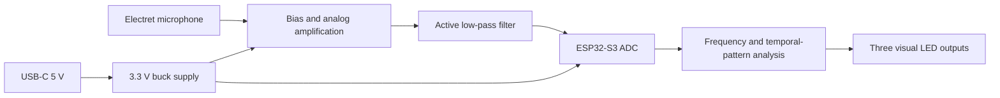

# PE-04 | ESP32-S3 Offline Chime Detector

**Practical Electronics (2314) · Winter 2026/27 · Rhine-Waal University of Applied Sciences**  
**Status: design-stage portfolio · simulated analog candidate and offline software feasibility; hardware validation not yet demonstrated**

A university team project exploring an **offline, visual-alert system** for recognizable household sounds. An electret microphone and analog signal-conditioning chain feed an ESP32-S3 microcontroller; intended embedded logic identifies selected sound frequencies and timing patterns and controls three separate LEDs. Target examples: appliance chime, doorbell and smoke-alarm *test* signal. **This is a demonstrator, not a certified alarm or assistive safety product.**

**PCB preview:** latest layout screenshot dated 18 November 2026 is available in the prepared local asset package and will be added here. The original editable PCB revision is still pending.

*Latest available layout screenshot (18 November 2026), provided by the team. This image does not prove DRC success, completed routing, fabrication, assembly or testing. The matching editable native PCB is still pending; older source files are explicitly archived.*

**Repository upload status (18 Nov 2026):** Technical documentation is committed. Image/PDF/KiCad binary evidence is staged locally but is **not yet uploaded to GitHub**. This is intentionally explicit so links and visuals do not falsely imply completed uploads. See [asset transfer instructions](ASSETS_TO_UPLOAD.md).

## Engineering summary

| Subsystem | Intended design |
| --- | --- |
| Microcontroller | ESP32-S3-WROOM-1; ADC sampling and three LED outputs |
| Power | USB-C 5 V input; switching buck supply for 3.3 V circuitry |
| Analog input | Electret microphone, DC bias, AC coupling, ~1.65 V analog reference |
| Front end | AD8656 preamplifier; TLV9062 two-stage/fourth-order low-pass filter in later KiCad architecture |
| Offline DSP | Development-stage Goertzel narrow-band tone measurement plus timing constraints |
| Indicators | Individually controlled red, green and blue LEDs |
| Mechanical form | Two-layer KiCad PCB, ESP32 antenna keep-out visible |

## Evidence from development

### 1) Analog circuit exploration · LTspice

**Plot preview pending upload:** the original LTspice Bode-frequency-response screenshot and related waveform/cursor screenshots are preserved in the local asset package.

- Built and investigated a **3.3 V microphone signal-conditioning candidate** using an idealized electret-current source, an approximately 1.65 V reference, and a nominal **11× (20.8 dB) non-inverting gain**.
- Used AC frequency sweeps and transient simulations; investigated PSpice model compatibility, numerical convergence, a noisy supply, startup behavior and simple passive-tolerance corners.
- In the **earlier generic-op-amp third-order low-pass candidate**, simulated filter-only attenuation was **−1.103 dB near 2.07 kHz** and **−34.263 dB near 14.0 kHz** for the nominal components. These are **not measurements of the later KiCad AD8656/TLV9062 circuit**.

[LTspice methodology and limitations](docs/ltspice-experiments.md) · 36-page experiment report (PDF upload pending)

### 2) Offline sound analysis · experimental Python/Goertzel

**Spectrogram pending upload:** the original analyzed doorbell and smoke-detector recording plot is preserved in the local asset package.

Early frequency-threshold-only detection produced **false positives on hand claps**, motivating a more robust analysis based on **tone purity, beep duration and repeated-event timing**. A saved Google Colab development notebook (recorded in the report, original notebook not yet uploaded) yielded expected alert counts on **four development recordings**: **1, 1, 1 and 0**. These are small-sample *development-file results*, not a measured real-world detection accuracy. The additional doorbell and smoke-test recording spectrograms are characterizations, not a claim of implemented multi-sound firmware.

[Sound analysis notes](docs/sound-analysis.md) · Full report and notebook-code listing (PDF upload pending)

### 3) Hardware architecture · KiCad

The later KiCad design describes eight functional blocks: **USB-C interface**, **3.3 V buck**, **microphone bias**, **midrail reference and preamp**, **fourth-order low-pass**, **ADC interface**, **ESP32 control**, and **visual indicators**. The new screenshot illustrates physical board placement and routing; a verified matching latest native design file has **not** been supplied. Earlier KiCad originals are maintained as a dated archive rather than mislabeled as this revision.

[Hardware architecture](docs/hardware-architecture.md) · 8-block circuit guide (PDF upload pending) · [Historical KiCad archive notes](hardware/archive/earlier-kicad-sources/)

## Design revisions and evidence boundaries

The **October LTspice prototype** and **later team PCB** are **different circuit iterations**:

| Earlier independent LTspice exploration | Later team KiCad design |
| --- | --- |
| Generic UniversalOpamp2 used for the successful two-stage simulation; single manufacturer MCP6021-family model also explored | AD8656 preamp and TLV9062 filter op amps |
| Second-order Sallen–Key plus output RC (three low-pass poles in total) | Two cascaded second-order active low-pass stages (four poles) |
| Simulated AC/transient behavior and model limitations reported | Design documented in team schematic guide and layout screenshot; hardware verification pending |

**Do not transfer the LTspice numbers to the later board as if they were tested board specifications.**

## Current status and next milestones

| Work item | Current evidence |
| --- | --- |
| Requirements and system architecture | Documented |
| Recorded-sound characterization | Documented for microwave, doorbell and smoke-detector test signal |
| Offline Goertzel software feasibility | Four development recordings documented; original notebook not yet included |
| Earlier analog circuit simulations | Screenshots, measurements and lab report available; original LTspice `.asc` files still required |
| Latest PCB layout | Screenshot available (18 Nov 2026), editable matching `.kicad_pcb` pending |
| ERC / DRC | No passing result provided |
| Fabrication / assembly / real ADC measurement | Not yet verified |
| On-device ESP32 sound classification | Not yet verified |

**Next:** obtain matching latest `.kicad_sch`, `.kicad_pcb`, `.kicad_pro`; run and log ERC/DRC; add original `.asc` and notebook; document board bring-up, real ADC samples, firmware and independent sound tests. See [verification plan](docs/status-and-next-steps.md).

## Repository map

| Location | Contents |
| --- | --- |
| `images/` (upload pending) | Supplied PCB screenshots, LTspice plots and sound spectrogram |
| [`docs/`](docs/) | Technical design notes, historical test interpretation, limitations |
| [`reports/`](reports/) | PDFs pending upload; report summaries and context documented |
| [`hardware/`](hardware/) | Archive notes published; older native KiCad binaries and matching latest source pending |
| [`simulation/`](simulation/) | Add reproducible `.asc` schematics and SPICE models when available |
| [`software/`](software/) | Add original Colab notebook and later ESP32 firmware when available |

## Team and attribution

**PE-04 is a team project.** The PCB design screenshots attribute work to **Ahmed Yehia Mohamed** and **Muhammad Ans** (some screenshots use a different transliteration). The development report documents prior LTspice and acoustic investigations; individual authorship of every team schematic and PCB block has not been independently resolved. This repository describes the work represented by the supplied materials, not exclusive ownership of the entire group design.

Before publishing publicly, review team attribution, any class policy and third-party asset/model redistribution rights. No third-party license is claimed here.