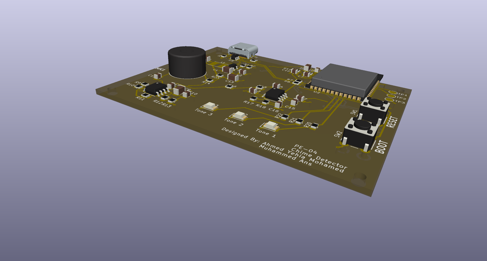
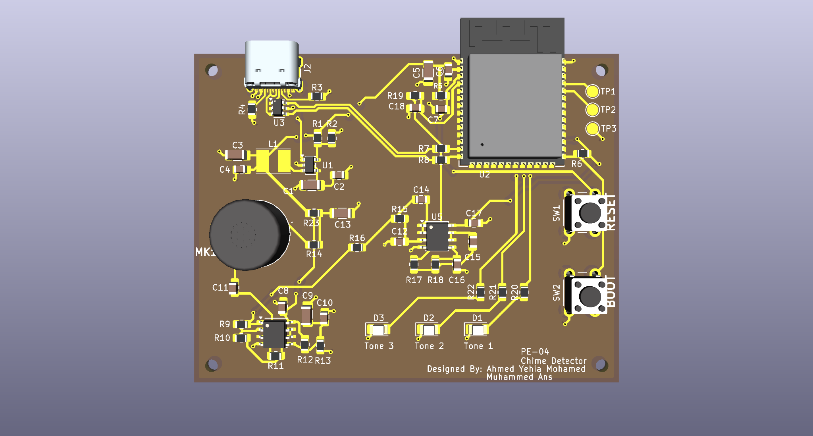
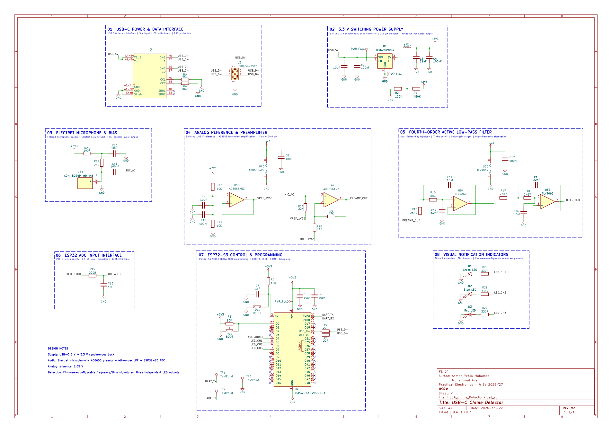

# PE-04 | ESP32-S3 Offline Chime Detector

**Practical Electronics · Mechatronic Systems Engineering · Rhine-Waal University of Applied Sciences**

`ESP32-S3` · `KiCad 10` · `PCB design` · `Analog electronics` · `LTspice` · `Goertzel`

I'm working on a USB-C-powered board that listens for familiar household chimes and gives a visual indication using three LEDs. The idea is to identify the sound locally from its frequency and timing pattern rather than relying on cloud audio processing.

My part of the project has included analysing sound recordings, testing the microwave-beep detection method, working through the analog microphone circuit in LTspice and collaborating on the KiCad schematic and PCB design.

*KiCad 3D view of the 22 November 2026 V2 design. This is a computer render, not a photograph of a soldered board.*

## Project files

| | |
| --- | --- |
| **Complete schematic** | [View PDF](exports/PE04_V2_schematic.pdf) · [Editable KiCad schematic](hardware/current/PE04_Chime_Detector.kicad_sch) |
| **PCB design** | [Editable V2 PCB](hardware/current/PE04_Chime_Detector.kicad_pcb) · [PCB layout image](images/pcb/v2-pcb-layout.png) |
| **KiCad project** | [Project file, local footprints, symbols and 3D models](hardware/current/) |
| **Parts** | [V2 assembly BOM](procurement/PE04_V2_Assembly_BOM.csv) · [Supplier supplements](procurement/) |
| **Documentation** | [Circuit design](docs/hardware-architecture.md) · [PCB layout](docs/pcb-layout.md) · [LTspice](docs/ltspice-experiments.md) · [Sound analysis](docs/sound-analysis.md) |
| **Build log** | [Assembly and testing](docs/assembly-and-testing.md) |

## PCB design

| Parameter | V2 design |
| --- | --- |
| Microcontroller | ESP32-S3-WROOM-1 |
| Supply | USB-C 5 V; TLV62569 buck regulator to nominal 3.3 V |
| Audio input | AOM-5024P-HD-MB-R electret microphone |
| Analog front-end | AD8656ARZ preamplifier; TLV9062 fourth-order active low-pass |
| ADC / outputs | GPIO4 (ADC1_CH3); three independent LED channels |
| Board | 74.3 × 57.5 mm · 2 copper layers · 1.6 mm |
| Placement | 57 electronic components + four M2 mounting holes |

*The V2 layout showing the copper tracks, component placement, test points and ESP32 antenna keep-out.*

*KiCad top view. All of the files used for this render are included under `hardware/current/`.*

[PCB layout notes](docs/pcb-layout.md)

## Schematic and circuit architecture

The schematic is organized into eight blocks: USB-C, the 3.3 V buck supply, microphone bias, analog reference and preamplifier, active low-pass filter, ADC input, ESP32-S3 and the three indicators.

**Microphone → AC coupling → AD8656ARZ → TLV9062 filter → ESP32-S3 ADC → LED outputs**

[Open the full-resolution schematic PDF](exports/PE04_V2_schematic.pdf) · [See all eight circuit blocks with explanations](docs/hardware-architecture.md)

## Sound-analysis work

I analysed a microwave chime, doorbell and smoke-alarm test sound. The microwave completion tone sits close to 2,050 Hz. I first tried frequency-based detection, but hand claps caused false triggers. The next offline Python version used a Goertzel tone check, tone-purity threshold and three-beep timing rule.

The four development recordings gave alert counts of **1, 1, 1 and 0**, matching the expected counts for the two microwave recordings, the microwave-with-claps recording and the clap-only recording. This was an offline test on four files, not a measured accuracy rate for the finished device. Doorbell and smoke-alarm recognition still need separate detection rules.

[Read the sound-analysis notes](docs/sound-analysis.md)

## LTspice experiments

I used LTspice to explore microphone biasing, the 1.65 V analog reference, preamplifier gain, filtering and transient behaviour. I also investigated a supplier op-amp model that had convergence issues in a multi-stage circuit.

The saved early amplifier-plus-RC-filter simulation reads **+20.08 dB at 2.054 kHz** for `V(adc_out)/V(mic_raw)`. This plot belongs to that development circuit; it is not a measurement or complete simulation of the current AD8656ARZ/TLV9062 board.

[View the original LTspice screenshots and notes](docs/ltspice-experiments.md)

## Build status

| Work | Status |
| --- | --- |
| V2 KiCad schematic, PCB and local libraries | Available |
| V2 schematic PDF, PCB layout and 3D views | Available |
| Parts list and assembly BOM | Available |
| Microwave detection experiments | Offline tests documented |
| LTspice front-end experiments | Screenshots documented |
| KiCad ERC/DRC results | Not recorded in this repository |
| Board soldering and first power-up | Pending |
| ESP32 firmware and on-board sound recognition | Pending |

After assembly we'll add board photographs, power measurements, analog test waveforms and the actual firmware results to the [build log](docs/assembly-and-testing.md). The original LTspice `.asc` projects and Python notebook/WAV test files are not yet included.

**Team:** Muhammad Ans and Ahmed Yehia Mohamed (shared schematic and PCB work).

*PE-04 is a student demonstrator, not a certified smoke-alarm or life-safety device.*
