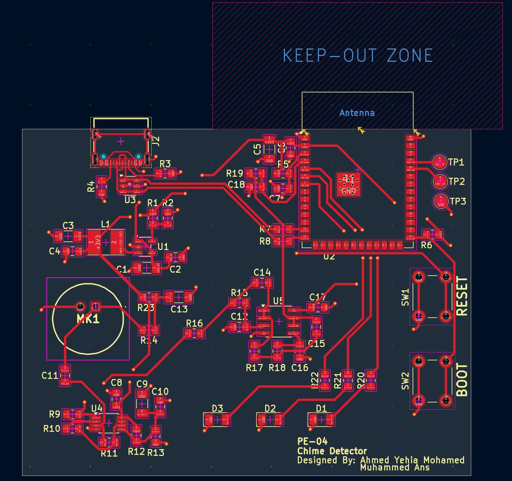

# Hardware design | PE-04

*Technical notes maintained by Muhammad Ans*

## System overview

I worked on integrating and reviewing the microphone signal path, analog conditioning, power and microcontroller interfaces in our KiCad design. The board is intended to provide three visual notification channels after the ESP32-S3 processes sampled audio.

```text
USB-C 5 V -> TLV62569 buck -> 3.3 V supply
                         |
Electret mic -> AC coupling -> AD8656 preamp -> TLV9062 low-pass
                                                    |
                                              ADC input RC
                                                    |
                                            ESP32-S3 GPIO4
                                                    |
                                           3 LED output pins
```



## Power and USB-C

The USB-C connector (J2, 629722000214) includes separate 5.1 kΩ CC pull-down resistors (R3 and R4) and the USBLC6-2SC6 ESD protection device (U3). A TLV62569DBV buck converter (U1), 2.2 µH inductor (L1) and 450 kΩ / 100 kΩ feedback network provide a nominal 3.3 V rail from USB 5 V.

This supply powers the ESP32-S3 and analog circuitry. Regulator layout, current margin and power integrity still need electrical and bench verification.

## Microphone input and analog reference

The microphone in the saved KiCad design is the AOM-5024P-HD-MB-R (MK1).

- R14: 2.2 kΩ microphone bias.
- R23 and C13: 100 Ω and 10 µF microphone-supply filtering.
- C11: 100 nF audio AC-coupling capacitor.
- R11: 22 kΩ input reference path. Together with C11, it gives a simple nominal high-pass estimate near 72 Hz.
- R12/R13: 10 kΩ divider setting the nominal 1.65 V midpoint.
- C9/C10: 10 µF and 100 nF reference filtering.
- U4B: the second AD8656 amplifier, configured as a buffer for the analog reference.

The microphone's AC signal is biased around this reference so a single-supply ADC stage can handle positive and negative audio excursions.

## Amplification and low-pass filtering

The AD8656 section U4A forms the preamplifier. R9 = 47 kΩ and R10 = 4.7 kΩ set a nominal non-inverting gain of `1 + 47/4.7 = 11`, or about 20.8 dB.

The TLV9062 (U5) implements two second-order active low-pass stages:

| Stage | Resistors | Capacitors |
| --- | --- | --- |
| First | R15 / R16 = 2.49 kΩ each | C12 = 8.2 nF; C14 = 10 nF |
| Second | R17 / R18 = 2.67 kΩ each | C15 = 22 nF; C16 = 3.3 nF |

The target is a fourth-order response around 7 kHz. R19 = 220 Ω and C18 = 1 nF condition the signal at ESP32-S3 GPIO4 / ADC1_CH3.

The separate [LTspice investigation](ltspice-experiments.md) uses an earlier analog circuit. I am not using those plots as the measured response of this integrated board.

## Controller and LED outputs

U2 is an ESP32-S3-WROOM-1. The design includes RESET and BOOT controls and three indicator channels:

| Reference | LED color | Series resistor |
| --- | --- | --- |
| D1 | Green | R20 = 330 Ω |
| D2 | Blue | R21 = 330 Ω |
| D3 | Red | R22 = 330 Ω |

Specific LED manufacturer parts and a sound-to-color assignment remain to be selected. The resistor values need checking against actual forward voltage and brightness requirements.

## KiCad files and BOM

The editable sources below are from an earlier revision than the November PCB screenshot:

- [KiCad schematic](../hardware/archive/earlier-kicad-sources/PE04_Chime_Detector_Schematics.kicad_sch)
- [KiCad PCB](../hardware/archive/earlier-kicad-sources/PE04_Chime_Detector_Schematics.kicad_pcb)
- [Project settings](../hardware/archive/earlier-kicad-sources/PE04_Chime_Detector_Schematics.kicad_pro)
- [Design-value BOM](../hardware/archive/earlier-kicad-sources/pe04-design-bom.csv)

## Next tests

1. Save the matching native schematic/PCB/project files for the latest layout and run KiCad ERC and DRC.
2. Check track completion, microphone polarity/footprint, USB-C connections, antenna keep-out and buck layout.
3. Select an ESP32 ADC sample rate and verify that analog filtering provides enough anti-alias rejection. The 16 kHz rate used in offline Python experiments is not yet the hardware sample rate.
4. Measure 3.3 V and 1.65 V, preamplifier swing and filter response on assembled hardware.
5. Select the LEDs, confirm current and brightness, and test each visual output.
