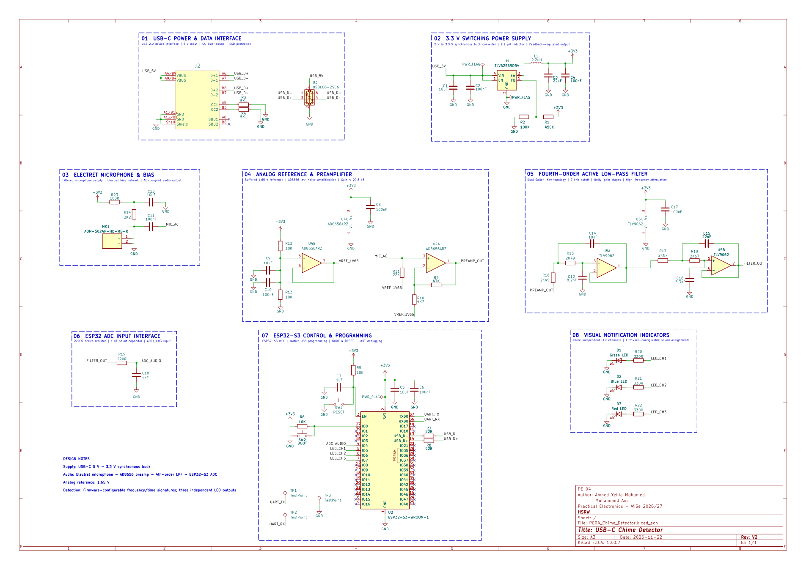
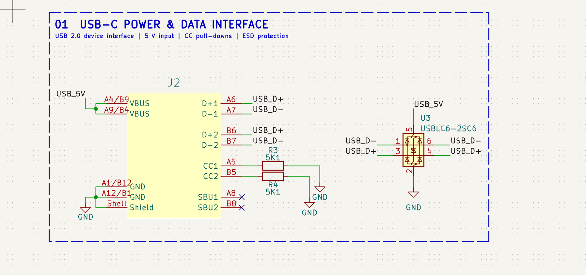
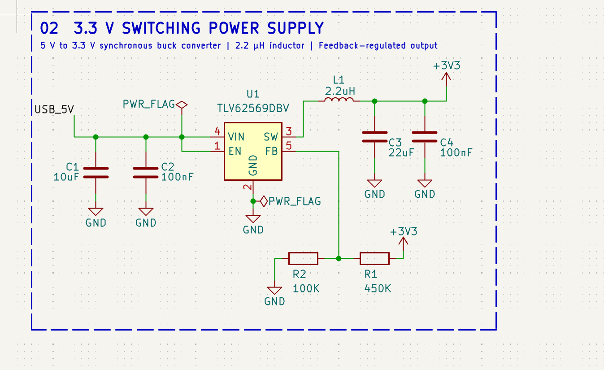
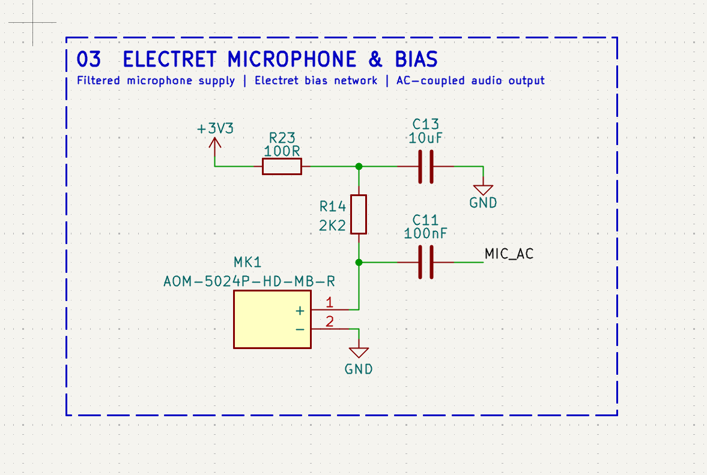
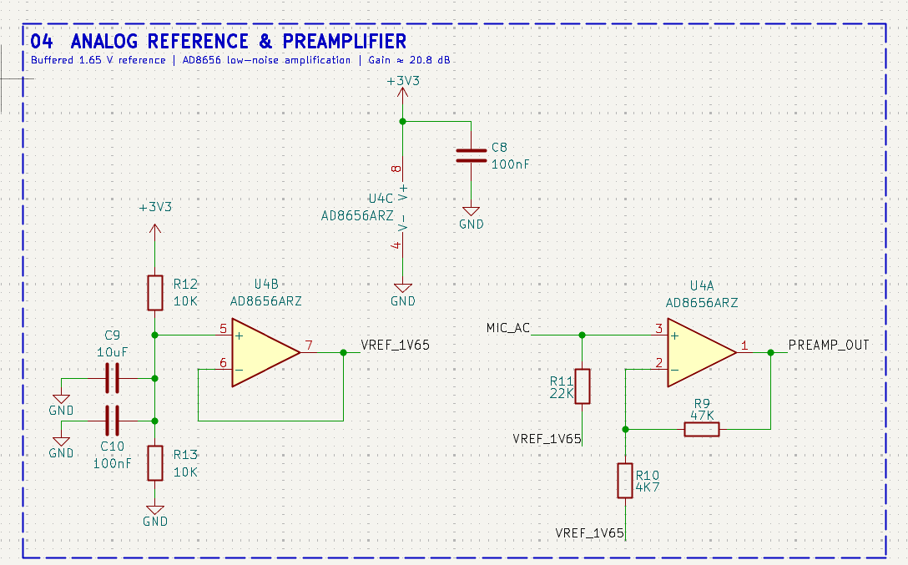
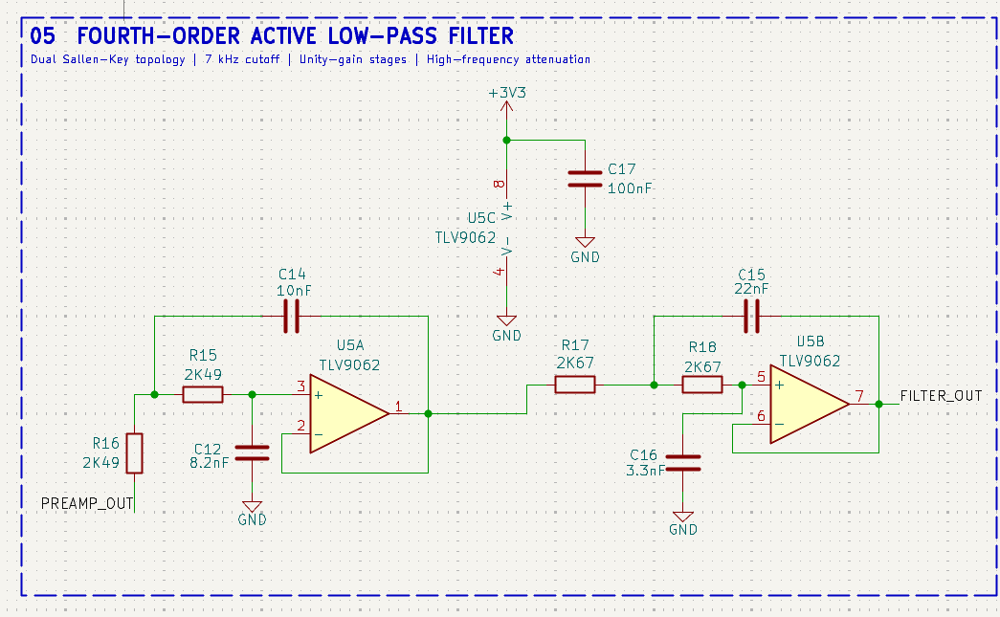
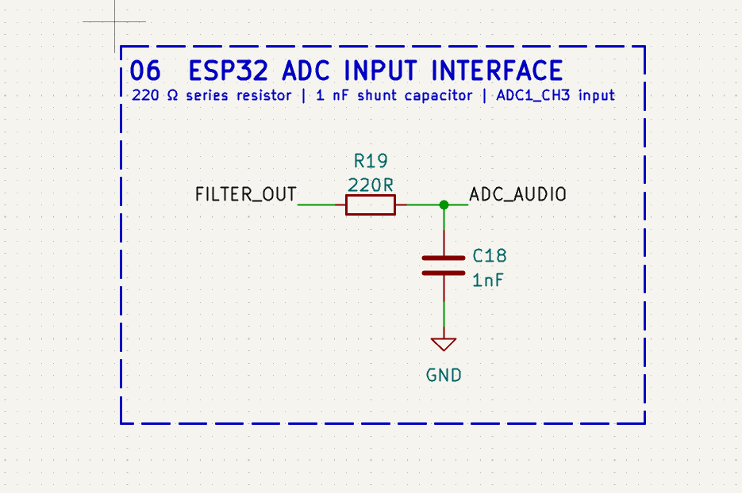
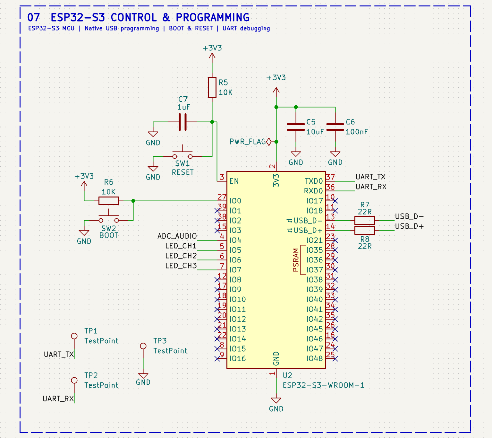
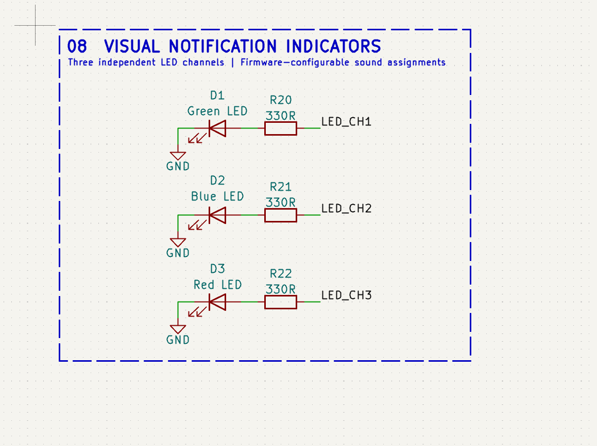

# PE-04 | Circuit Design (V2)

The current schematic is revision **V2**, dated **22 November 2026**. It is divided into eight functional blocks. These are screenshots from our KiCad design, not redrawn diagrams.

[Open the complete one-page A3 schematic (PDF)](../exports/PE04_V2_schematic.pdf) · [Editable KiCad schematic](../hardware/current/PE04_Chime_Detector.kicad_sch) · [V2 PCB](../hardware/current/PE04_Chime_Detector.kicad_pcb)



## 01 · USB-C power and data



The USB-C connector **J2** brings in `USB_5V` and the USB 2.0 D+/D− lines. **R3 and R4 (5.1 kΩ)** are the separate CC pull-down resistors. **U3 (USBLC6-2SC6)** protects the USB data pair against ESD.

The D+/D− connections continue to the ESP32-S3, with 22 Ω series resistors in the microcontroller block. The connector's SBU pins are unused in this design.

## 02 · 3.3 V switching supply



**U1 (TLV62569DBV)** steps down the USB 5 V input to the designed 3.3 V rail. The circuit uses **L1 = 2.2 µH** and a feedback divider of **R1 = 450 kΩ** and **R2 = 100 kΩ**.

The input is decoupled with **C1 = 10 µF** and **C2 = 100 nF**; the output uses **C3 = 22 µF** and **C4 = 100 nF**. The 3.3 V rail supplies the ESP32-S3 and the analog stages.

## 03 · Electret microphone and bias



**MK1** is the **AOM-5024P-HD-MB-R** electret microphone. **R14 = 2.2 kΩ** provides its bias. Before reaching the microphone, the 3.3 V supply passes through **R23 = 100 Ω**, with **C13 = 10 µF** to ground, to reduce supply interference at the microphone node.

**C11 = 100 nF** AC-couples the microphone output to the amplifier. The input reference path at the next stage uses **R11 = 22 kΩ**; the simple `R11/C11` high-pass estimate is about **72 Hz**.

## 04 · Buffered reference and preamplifier



Because the circuit runs on one 3.3 V rail, the microphone signal is amplified around a nominal **1.65 V reference**, not around ground. **R12/R13 = 10 kΩ** create the midpoint, **C9 = 10 µF** and **C10 = 100 nF** smooth it, and **U4B** buffers the reference.

The other half of the **AD8656ARZ**, **U4A**, is the non-inverting gain stage. **R9 = 47 kΩ** and **R10 = 4.7 kΩ** give:

```text
Av = 1 + (R9 / R10)
   = 1 + (47 kΩ / 4.7 kΩ)
   = 11 V/V  ≈ 20.8 dB
```

This is the intended resistor-ratio gain; no physical gain measurement has been made yet.

## 05 · Fourth-order active low-pass filter



The **TLV9062 (U5)** is used for two cascaded unity-gain Sallen-Key sections. The design targets a fourth-order low-pass response with a cutoff around **7 kHz**.

| Stage | Resistors | Capacitors |
| --- | --- | --- |
| First (U5A) | R15/R16 = 2.49 kΩ | C12 = 8.2 nF; C14 = 10 nF |
| Second (U5B) | R17/R18 = 2.67 kΩ | C15 = 22 nF; C16 = 3.3 nF |

The complete filter response has not yet been confirmed by a matching-part simulation or measurements on assembled hardware.

## 06 · ESP32 ADC input interface



The filtered audio passes through **R19 = 220 Ω** to the `ADC_AUDIO` net, with **C18 = 1 nF** to ground. This is connected to **ESP32-S3 GPIO4 / ADC1_CH3**.

The analog sampling rate still has to be chosen for firmware. The 16 kHz rate in the offline Python test was the recording-analysis rate, not a verified board ADC setting.

## 07 · ESP32-S3 control and programming



**U2** is the **ESP32-S3-WROOM-1**. The schematic includes the native USB D+/D− connections through **R7/R8 = 22 Ω**, pull-ups and buttons for **RESET (SW1)** and **BOOT (SW2)**, and **UART_TX / UART_RX** test points. The 3.3 V supply is decoupled with **C5 = 10 µF** and **C6 = 100 nF**.

The ADC audio input is on **GPIO4**. The three LED channels use **GPIO5, GPIO6 and GPIO7**. Firmware and USB bring-up are still part of the next stage.

## 08 · Visual indicator outputs



The board has three independently controlled LED outputs:

| Channel | LED | Series resistor | GPIO |
| --- | --- | --- | --- |
| LED_CH1 | D1, green | R20 = 330 Ω | GPIO5 |
| LED_CH2 | D2, blue | R21 = 330 Ω | GPIO6 |
| LED_CH3 | D3, red | R22 = 330 Ω | GPIO7 |

The supplier parts lists select Kingbright LEDs. The board labels read `Tone 1`, `Tone 2` and `Tone 3`, but the final firmware mapping from household sounds to the LEDs has not been implemented.

## PCB and project files

The [V2 PCB layout notes](pcb-layout.md) show the actual routing and KiCad 3D views. The complete editable KiCad project is in [`hardware/current/`](../hardware/current/), including local footprint/symbol libraries, two STEP models and the design-rule file. The [assembly BOM](../procurement/PE04_V2_Assembly_BOM.csv) comes from the V2 source.

We still need to record KiCad ERC/DRC results and check the finished board after soldering. The schematic and renders show the design, not tested hardware.
