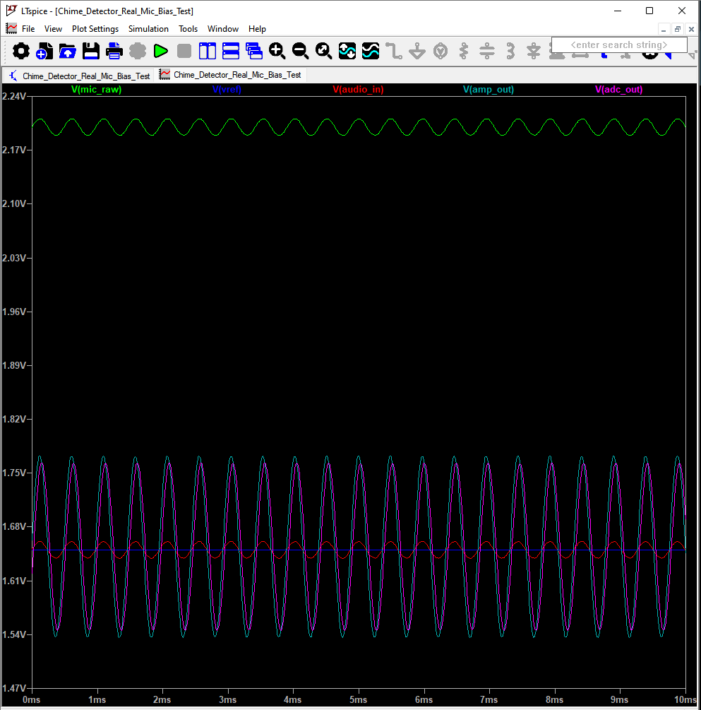

# LTspice Microphone Front-End Experiments

## Aim

Before the integrated KiCad design, I used LTspice to test the basics of a microphone input: bias, small-signal amplification, analog filtering and the response of the 1.65 V reference at startup.

## Early amplifier and RC-filter test


This screenshot shows a simplified microphone source, nominal 3.3 V power, a 1.65 V reference, a non-inverting gain stage and a 3.3 kΩ / 10 nF output RC filter. The nominal RC corner is:

```text
f = 1 / (2πRC)
  = 1 / (2π × 3.3 kΩ × 10 nF)
  ≈ 4.8 kHz
```


The plotted transfer ratio is `V(adc_out)/V(mic_raw)`. It includes amplifier gain and the output RC filter. The [saved cursor](../images/ltspice/initial-ac-gain-cursor.png) reads **+20.0777 dB at 2.0536624 kHz**. This is the number visible in the supplied LTspice plot.

## Transient response and supply noise



I replaced the original ideal microphone-voltage test signal with a simple current-source model to explore the microphone bias path. I also checked whether the circuit could settle around its 1.65 V reference after power-up.

A separate test applied a small 5 kHz ripple to the ideal 3.3 V rail. I explored an RC branch at the microphone supply to reduce the ripple seen by the input stage. These were early simulation exercises, not measurements on the PCB.

## Op-amp model problem

I tried importing a Microchip MCP6021-family PSpice model for the analog stages. A single-model test worked, but multi-stage cases ran into numerical convergence problems. I moved to generic LTspice op-amp models for the follow-up circuit exploration rather than assuming the imported vendor model was working correctly.

I also experimented with an additional Sallen-Key filter stage. The original `.asc` file and matching plot for that run have not been added to GitHub, so I am not quoting its filter-only attenuation numbers here.

## Relation to the V2 PCB

The V2 board uses an **AD8656ARZ** for preamplification and reference buffering, and a **TLV9062** for two cascaded filter sections. Those are not the devices in the early screenshot above. The V2 circuit will need its own simulation or measured sweep.

### Files to add when recovered

- Original LTspice `.asc` schematic(s)
- Any model files that can legally be redistributed; otherwise a manufacturer download link
- Plot configuration and a saved run matching each screenshot

I want anyone opening the project to be able to distinguish what I simulated early on from what is actually present in the V2 schematic.
