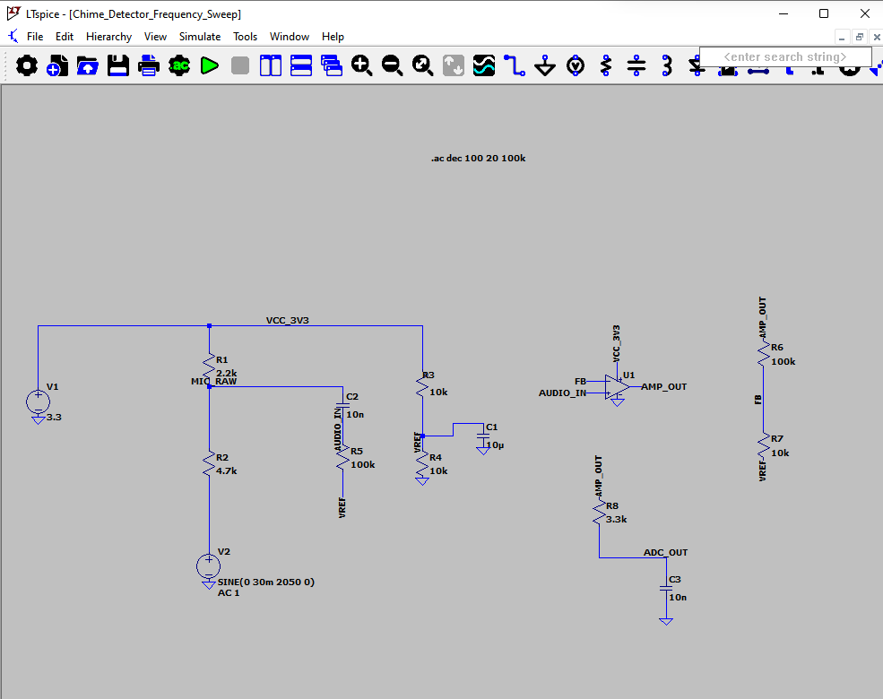
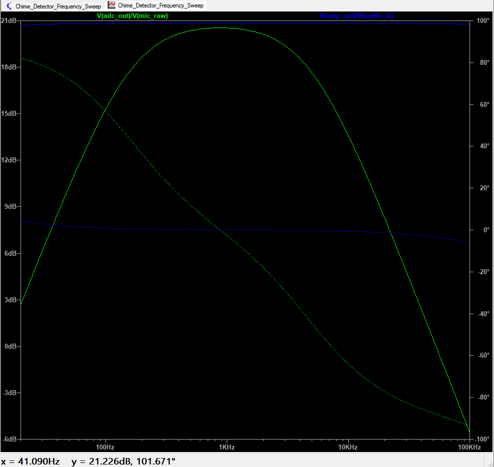

# LTspice: microphone analog-front-end experiments

## Objective

Investigate how a small electret-microphone signal could be biased, amplified and filtered before sampling with a 3.3 V microcontroller. This experiment predates the later KiCad circuit and uses **different op-amp/filter components**.

## Circuit studied

- An ideal 3.3 V source and simplified electret current-source representation.
- A mid-supply reference of approximately 1.65 V formed with 10 kΩ / 10 kΩ resistors and a reference capacitor.
- An amplifier stage with nominal non-inverting gain **1 + 100 kΩ / 10 kΩ = 11**, approximately **20.8 dB**.
- An earlier second-order unity-gain Sallen–Key stage followed by a 3.3 kΩ / 10 nF RC low-pass stage: third-order filtering overall.
- AC sweeps, transient simulations, a startup case and microphone-supply noise experiments.

## Frequency response

The successful combined study used generic op-amp models and measured the **filter-only** transfer function V(ADC_OUT)/V(AMP_OUT).

| Frequency | Simulated gain |
| --- | ---: |
| 501.53 Hz | −0.038 dB |
| 2,057.17 Hz | −1.093 dB |
| 3,007.03 Hz | −3.213 dB |
| 5,037.21 Hz | −10.592 dB |
| 8,115.82 Hz | −20.924 dB |
| 13,998.01 Hz | −34.244 dB |

A separate earlier single-stage cursor reading was approximately 20.08 dB at 2,053.66 Hz. These values belong to the documented simulation runs, not the current ESP32-S3 PCB.

## What required troubleshooting

**Op-amp model.** A manufacturer MCP6021-family macromodel was investigated. A single stage could be simulated, but attempts using two manufacturer-model instances ran into numerical convergence problems. The later combined run used LTspice generic op-amp models rather than treating a failing model as a successful device-level validation.

**Microphone representation.** The source was revised from an ideal sinusoidal voltage to a simplified current-source model. The model was for circuit behavior checks and did not establish the actual sensitivity of the final electret microphone.

**Supply ripple.** A simulation introduced ±20 mV at 5 kHz onto a nominal 3.3 V supply. An RC supply-decoupling approach (220 Ω and 10 µF) was explored to reduce microphone-bias interference.

**Transient and startup.** The 1.65 V reference took time to settle from power-up. Tests therefore separated startup behavior from settled audio waveforms.

## Design change after these experiments

The later KiCad project uses **AD8656** for amplification and **TLV9062** for a fourth-order filter consisting of two Sallen–Key stages. Results above must **not** be quoted as a verification of those later parts. To make the analog results reproducible, the original LTspice .asc files or a newly documented simulation of the actual KiCad circuit are still needed.
