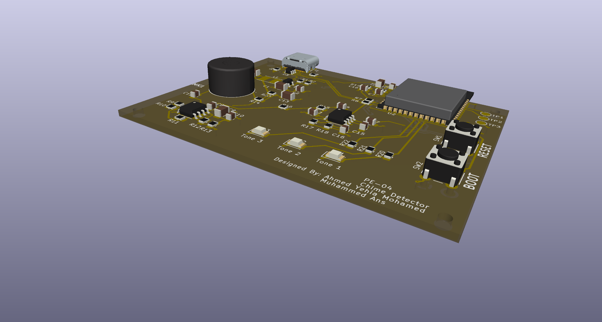
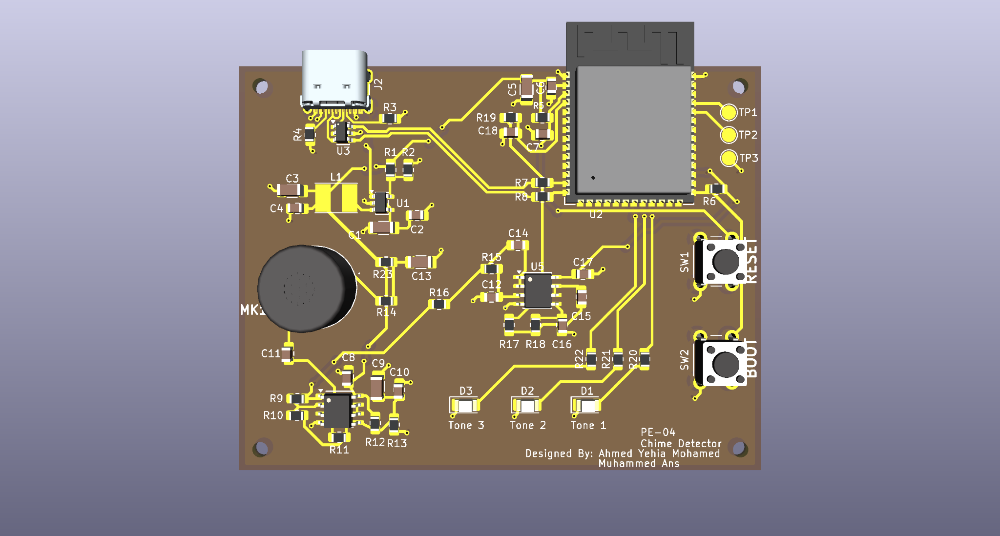
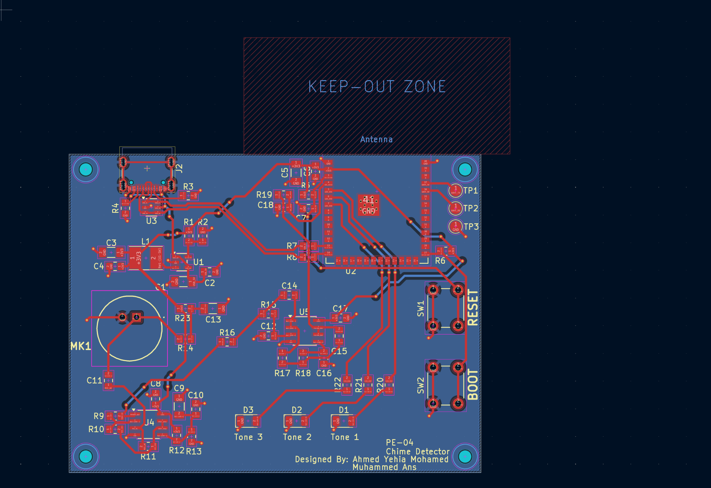

# PE-04 | PCB Layout (V2)

**KiCad 10 · Two-layer PCB · Revision V2, 22 November 2026**

I worked on this PCB as part of our Practical Electronics group project. The V2 board combines the USB-C supply, electret microphone front-end, active analog filter, ESP32-S3 and three LED indicators.

## 3D board views

*Angled view of the V2 PCB in KiCad's 3D Viewer.*

*Top view showing USB-C, microphone, analog stages, ESP32-S3, test points, BOOT/RESET and the three LEDs. These are virtual 3D renders, not photos of assembled hardware.*

## Routed PCB view

The screenshot shows the front copper routing, backside copper zone, footprint placement and antenna keep-out. The USB-C and buck regulator are at the power-input side, the microphone and analog circuit are grouped together, and the ESP32-S3 and indicators are on the right.

| Board detail | V2 file |
| --- | --- |
| Size | 74.3 × 57.5 mm |
| Thickness | 1.6 mm |
| Copper | F.Cu and B.Cu |
| Ground | B.Cu GND zone |
| Component positions | 57 electronic footprints |
| Mounting | Four M2 holes (H1–H4) |
| Test access | TP1, TP2 and TP3 |

The actual PCB source, not the screenshot, is the reference for nets, layers, dimensions and fabrication review.

## Open the design

- [Editable PCB](../hardware/current/PE04_Chime_Detector.kicad_pcb)
- [KiCad project](../hardware/current/PE04_Chime_Detector.kicad_pro)
- [Schematic](../hardware/current/PE04_Chime_Detector.kicad_sch)
- [Schematic PDF](../exports/PE04_V2_schematic.pdf)
- [Project-local symbols, footprints and 3D models](../hardware/current/libraries/)
- [Assembly BOM](../procurement/PE04_V2_Assembly_BOM.csv)

## Next: fabrication checks and bring-up

The current repository contains the V2 design but **no published passing ERC/DRC report**. Before assembly we need to inspect clearances, any unconnected pads or track ends, the ESP32 antenna keep-out and the buck/analog routing. Soldering, first power-up and real voltage measurements are also pending.

I'll add those results to the [assembly and bench-testing log](assembly-and-testing.md) when the board has been built.
