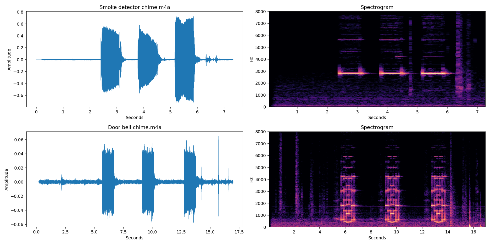

# Sound analysis | Microwave chime detection

*Audio-analysis work documented by Muhammad Ans*

## Starting with real recordings

I examined microwave, doorbell and smoke-detector test sounds to compare their frequencies, duration and repetition patterns. The practical problem was that a tone near the microwave's dominant frequency could also appear briefly during unrelated noise.

The doorbell shows a sequence of different tones. The smoke-detector test signal is around 2.8 kHz with onset spacing of roughly 1.35 seconds. The microwave's repeated tone is close to 2,050 Hz. Those patterns call for different detection criteria.

## Problem: claps triggered the first detector

In the early approach, a threshold near 2,050 Hz was enough to report an event. A clap-only recording caused false detections at approximately 5.504 s and 9.088 s. A short burst of energy at the right frequency was being mistaken for an actual microwave completion chime.

## My offline detection experiment

I tested a more selective Goertzel-based approach that looked for a narrowband tone and the timing of a complete three-beep sequence.

| Setting | Development value |
| --- | --- |
| Recording format | 16 kHz mono |
| Frame/window | 1,024 samples; Hann window |
| Hop | 160 samples (10 ms) |
| Frequency target | 2,050 Hz |
| Tone threshold | −55 dBFS |
| Minimum tonal purity | 0.60 |
| Allowed beep duration | 0.22–0.85 s |
| Onset interval | 0.50–0.95 s |

The Python recording-analysis experiment also used an offline Butterworth bandpass. That filtering arrangement cannot simply be copied into a causal streaming implementation on an ESP32.

## Development tests

| Test | Expected alerts | Reported alerts |
| --- | ---: | ---: |
| Microwave recording 1 | 1 | 1 |
| Microwave recording 2 | 1 | 1 |
| Microwave and claps | 1 | 1 |
| Claps only | 0 | 0 |

This is a development set of four recordings, rather than an accuracy benchmark. The original notebook and WAV files still need to be added so that the tests can be run by someone else.

## What I would build next

The doorbell requires recognition of its changing tone sequence, while the smoke-detector test signal requires different frequency and repetition settings. Neither is implemented in the current microwave-specific rules.

For embedded testing, the next tasks are selecting the ESP32 ADC sample rate, building causal audio processing, assigning LED indications and testing at different volumes, distances and background-noise levels.
